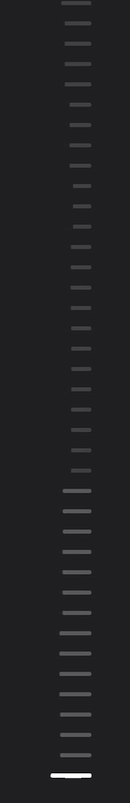

# dsh-audio-rail-macos

[](https://www.npmjs.com/package/dsh-audio-rail-macos) [](LICENSE)

> **不要在 macOS 上装 Windows 版的 [dsh-audio-rail](https://github.com/Lingwuxin/dsh-audio-rail)。** 它没声明 `os`，在 macOS 上也能装上，但采集器是 Windows 的 `.exe`，跑不起来；而且它注册的 `/audio-rail/events`、`/audio-rail/status` 与本插件同名——宿主对重复路由直接抛错，两个插件会有一个加载失败。Windows 用户请用那个版本，本插件只支持 macOS。
>
> **macOS 14.2+ 专用。** 首次运行需在「系统设置 → 隐私与安全性 → 音频录制」里授权（授权对象是 DeepSeek Harness 本身）；没授权时页面不会动，也不会报错。

DeepSeek Harness 会话页右侧那列跳转锚点（turn rail），跟着 Mac 正在播放的音乐跳。

只动几何：每根锚点是一条 2px 高的小白条，长度随它对应那段频谱起伏。不加颜色、不加发光、不覆盖宿主自己的状态长度——正在看的锚点仍然最长，没加载的仍然最短，音乐只是在这个长度上叠加脉冲。

## 长什么样



<sub>真机录制，只裁取右侧锚点区域（不含任何对话内容）；为看清跳动，画面提亮了 1.5 倍、放慢到 0.8 倍速。</sub>

12 段对数频谱（45 Hz – 16 kHz），低频在底部、高频在顶部，整列像一根竖起来的频谱仪。33 ms 一帧，attack/release 平滑，松手会自己落回去。

## 要求

- macOS 14.2 及以上（Core Audio Process Tap）。发布包里的采集器是 **arm64 + x86_64 通用二进制**，Apple Silicon 和 Intel 都能跑。
- 首次运行会在「系统设置 → 隐私与安全性 → 音频录制」里要求授权，被授权的是拉起采集器的进程（桌面端就是 DeepSeek Harness 本身）。
- 拒绝授权不会报错，页面就是不动；`/audio-rail/status` 会显示 `permission-denied`，此时不会反复重试空转。授权后**刷新页面**即可恢复（重新订阅就是重试）。

## 行为

- **只有页面在看时才采集**：至少一个标签页订阅着，采集器才运行；最后一个订阅断开 15 秒后自动退出，刷新页面会接上还在跑的那个。
- **不会留下孤儿进程**：宿主把 stdin 交给采集器，宿主退出（包括崩溃）时管道关闭，采集器读到 EOF 立刻退出，不会继续占着系统音频、让录音指示灯常亮。
- **换输出设备会自己适应**：默认输出改成耳机/蓝牙时，采集器会重建 tap 继续听新的设备，不需要重装或重启。

## 安装

从 npm：

```sh
dsh plugin --profile desktop add dsh-audio-rail-macos
```

从 GitHub（仓库里已带编译好的通用二进制，不需要 Swift 工具链）：

```sh
dsh plugin --profile desktop add github:Blueteemo/dsh-audio-rail-macos
```

本地开发（改动即时可见）：

```sh
dsh plugin --profile desktop add link:/path/to/dsh-audio-rail-macos
```

装完刷新页面（⌘R），放点音乐。

卸载：

```sh
dsh plugin --profile desktop remove dsh-audio-rail-macos
```

## 自检

宿主在 127.0.0.1 上只开两条 loopback 路由，可以直接 curl：

```sh
# 端口换成当前 GUI 的端口（应用里地址栏显示的 http://127.0.0.1:<port>）
curl -s http://127.0.0.1:<port>/audio-rail/status
```

期望：`{"platform":"darwin","status":"listening",...}`。`status` 依次可能是 `idle`（还没人订阅）、`starting`、`listening`、`permission-denied`、`error`、`unsupported`。

看实时帧（每行一个 `event: frame`，`bands` 是 12 个 0..1）：

```sh
curl -Ns http://127.0.0.1:58651/audio-rail/events | head -20
```

采集器本身也能单独跑：

```sh
./native/bin/dsh-audio-rail-tap | head -3
```

## 采集器

`native/` 里是自写的 Swift 采集器：Core Audio Process Tap → 2048 点 FFT（Hann 窗）→ 12 段对数频段 → 逐段相对归一化，stdout 出 NDJSON，33 ms 一帧。代码已编译进 `native/bin/dsh-audio-rail-tap`（arm64），改源码后重新编译：

```sh
npm run build:native
```

## 隐私

采集在本地进程里完成，音频不出机器；浏览器只从同源 loopback 路由读一个 12 个数字的数组，音频本身不上传。

## Credits

- `native/Sources/CoreAudioSupport.swift`、`native/Sources/SystemAudioTap.swift`：改编自 [dsh-bgm](https://github.com/skymecode/dsh-bgm)（MIT, © skymecode）。
- 浏览器端的注入思路（属性选择器跨 hash、把脉冲乘在宿主状态系数上、虚拟列表重扫）：借鉴 [dsh-audio-rail](https://github.com/Lingwuxin/dsh-audio-rail)（MIT, © Lingwuxin）。

## License

MIT，见 [LICENSE](./LICENSE)。
